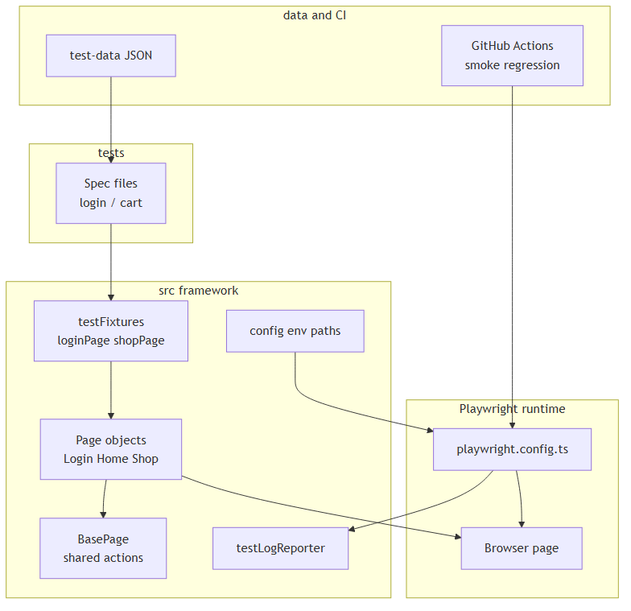
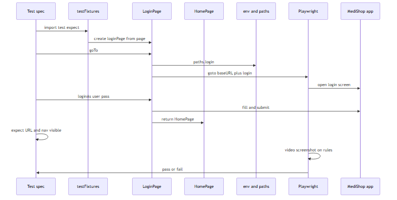
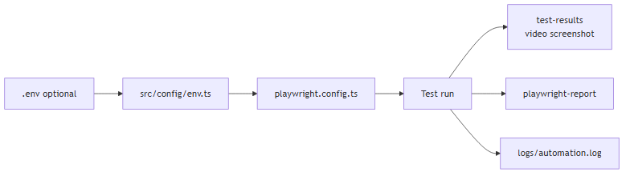

# SDET Playwright Framework (TypeScript)

End-to-end UI tests for [MediShop](https://www.way2automation.com/MediShopWebApp/) using **Playwright**, organized like a small **SDET framework**: reusable code in `src/`, tests in `tests/`, data in JSON.

**Goal:** Tests say *what* should happen. The framework handles *how* (pages, waits, config, reports).

### How to view the architecture diagrams

| Where you read the README | What you see |
| --- | --- |
| **GitHub** (browser) | PNG images below render automatically |
| **Cursor / VS Code** | Open `README.md` → **Markdown: Open Preview** (`Ctrl+Shift+V`), or open the `.png` files in `docs/diagrams/` |
| **Any file explorer** | Double-click `docs/diagrams/*.png` |

Source files to edit diagrams: `docs/diagrams/*.mmd` → regenerate PNGs: `npm run docs:diagrams`

---

## High-level architecture



| Layer | What it is | Why it helps |
| --- | --- | --- |
| **tests/** | Scenarios + `expect()` only | Easy to read; failures point to business intent |
| **fixtures** | Ready-made `loginPage`, `shopPage` | No copy-paste setup in every spec |
| **pages/** | Locators + user actions | UI change = fix one file, not every test |
| **base/** | Click, fill, wait helpers | Same timeout and style everywhere |
| **config/** | URL, timeouts, routes | Run same tests on different envs |
| **reporters** | Console + `logs/automation.log` | Audit trail like a TestNG listener |
| **playwright.config** | Browser, video, screenshot, retries | One place for run behaviour |
| **test-data/** | Users, products in JSON | Data is not buried in code |
| **CI** | Smoke on PR, full/regression on schedule | Fast feedback + deeper checks |

---

## Data flow: one test run

Example: *valid login* (`tests/login/login.spec.ts`).



**Cart flow** is the same pattern: spec → fixtures → `loginPage` (login) → `shopPage` (search, add, cart) → assertions in the spec.

---

## Data flow: config and reporting



| Output | When you use it |
| --- | --- |
| `npx playwright show-report` | Shareable HTML, videos attached |
| `test-results/.../video.webm` | Raw recording per test |
| `logs/automation.log` | Plain-text pass/fail log |

---

## Folder map

```text
src/           Framework (no assertions on app behaviour)
  base/        Shared page helpers
  config/      env.ts, paths.ts
  pages/       LoginPage, HomePage, ShopPage, NavComponent
  fixtures/    Extended test with page fixtures
  reporters/   testLogReporter.ts
tests/         Specs only
test-data/     login.json, medicine.json
docs/diagrams/ Architecture PNG + Mermaid source (.mmd)
```

---

## Design rules (3)

1. **Assertions** → only in `tests/`.
2. **Locators** → only in `src/pages/` (and `components/`).
3. **URLs and timeouts** → `src/config/`, not hard-coded in specs.

Page methods **return** the next page when it helps (e.g. `loginAs` → `HomePage`).

---

## Quick start

```bash
npm ci
npm test                 # all tests
npm run test:smoke       # @smoke
npm run test:regression  # @regression
npx playwright show-report
```

| Variable | Default |
| --- | --- |
| `BASE_URL` | MediShop URL |
| `HEADLESS` | `false` local; `true` when `CI` is set |
| `EXPLICIT_WAIT_MS` | `30000` |
| `VIDEO` | `on` (use `retain-on-failure` to save disk) |

Copy `.env.example` to `.env` if you want local overrides (set env vars in the shell or load `.env` yourself).

---

## Tags and CI

| Tag | Purpose |
| --- | --- |
| `@smoke` | Fast checks (login happy paths) |
| `@regression` | Broader checks (invalid login, cart) |

GitHub Actions: **smoke** on pull requests; **full** on push to `main`; **regression** on schedule / manual dispatch.

---

## App under test

[Way2Automation MediShop](https://www.way2automation.com/MediShopWebApp/) — login, shop search, add to cart (demo training app).
